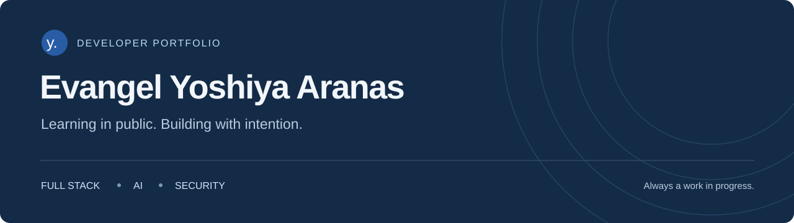
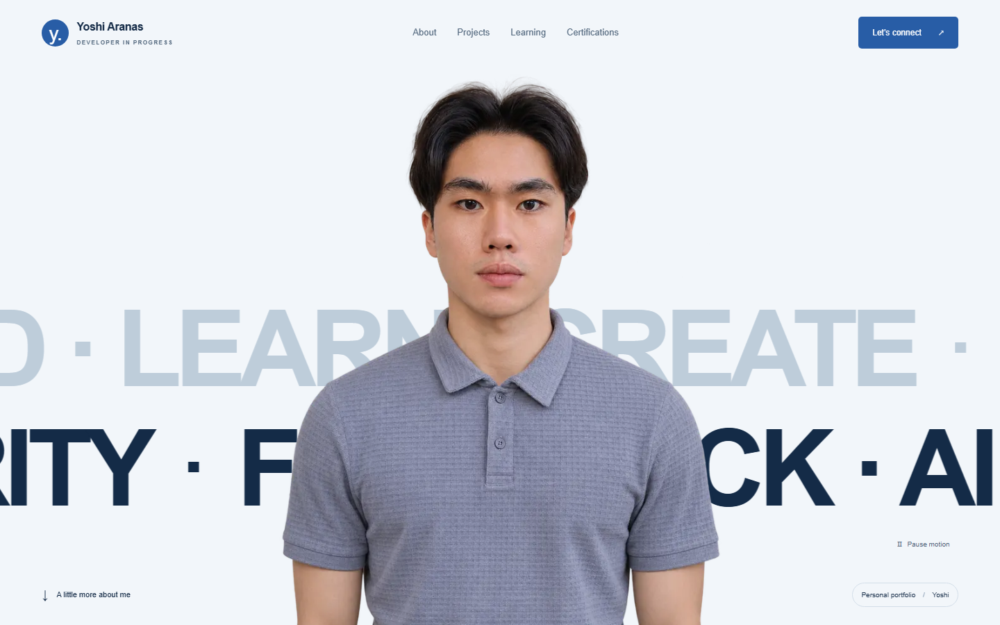

<p align="center">
  
</p>

<p align="center">
  A personal space for the things I build, the ideas I explore, and the lessons I keep.
</p>

<p align="center">
  <a href="https://nextjs.org/"></a>
  <a href="https://react.dev/"></a>
  <a href="https://www.typescriptlang.org/"></a>
  <a href="https://tailwindcss.com/"></a>
</p>

<p align="center">
  <a href="#a-closer-look">Overview</a> ·
  <a href="#run-it-locally">Run locally</a> ·
  <a href="#selected-work">Selected work</a> ·
  <a href="#make-it-your-own">Edit content</a> ·
  <a href="https://www.linkedin.com/in/evangel-yoshiya-aranas-88b352414/">LinkedIn</a>
</p>

<br />



<br />

## A closer look

A responsive portfolio built with the **Next.js App Router**, **TypeScript**, and **Tailwind CSS**. Soft blue surfaces, navy typography, and purposeful interactions keep the focus on the work.

| Experience | What you’ll find |
| :--- | :--- |
| **Portrait-led introduction** | Oversized text moving in opposite directions behind a transparent portrait, with a pause control. |
| **Projects you can inspect** | Category filters, keyboard-accessible project tabs, a real storefront preview, and direct repository links. |
| **Learning in progress** | Expandable areas covering full-stack development, AI engineering, networking, cybersecurity, and computer engineering. |
| **Credentials with sources** | 42 LinkedIn-listed entries with search, issuer filters, original titles, and credential links. |
| **Small details that matter** | Scroll arrivals, visible keyboard focus, reduced-motion support, and clipboard feedback. |

No UI framework, animation library, database, or account setup is needed to run this portfolio.

## Run it locally

Use a current **Node.js LTS** release and npm. Next.js requires Node.js **20.9 or newer**.

```sh
git clone https://github.com/Yoshi-dev-mode/evangel-yoshiya-portfolio.git
cd evangel-yoshiya-portfolio
npm ci
npm run dev
```

Open [localhost:3000](http://localhost:3000). No environment variables or credentials are required.

| Command | Purpose |
| :--- | :--- |
| `npm run dev` | Start the development server |
| `npm run build` | Create the production build |
| `npm start` | Serve the production build |
| `npm run lint` | Check code quality |
| `npm run typecheck` | Check TypeScript types |

Deploy as a standard Next.js application on a compatible Node.js host or a Next.js hosting provider.

## Selected work

The portfolio features these public projects. Descriptions and technologies follow their repository sources.

| Project | Focus | Technologies |
| :--- | :--- | :--- |
| [Yoshiya Storefront](https://github.com/Yoshi-dev-mode/e-commerce-website-project) | Restaurant ordering flow with a demo checkout | Next.js · TypeScript · Supabase · PostgreSQL |
| [Kabisera Ledger](https://github.com/Yoshi-dev-mode/kabisera-ledger) | Small-business ledger prototype and manual recordkeeping | Next.js · TypeScript · Tailwind CSS · Supabase |
| [MediVault](https://github.com/Yoshi-dev-mode/MediVault-Group-1) | Medical record management group project | Flask · MySQL · Nginx · Ubuntu |
| [Network Incident Investigation](https://github.com/Yoshi-dev-mode/network-incident-investigation) | Evidence-based cybersecurity training investigations | tcpdump · DNS · TCP · HTTP |

## Make it your own

Content, presentation, and interactions live in separate files so updates stay straightforward.

```text
app/
  page.tsx                   Page structure and sections
  layout.tsx                 Metadata and document layout
  globals.css                Base styles and portrait hero
  portfolio.css              Styles for the sections below the hero
components/
  hero.tsx                   Portrait, marquees, and pause control
  project-explorer.tsx       Project filters and keyboard navigation
  certification-explorer.tsx Certification search and issuer filters
  learning-explorer.tsx      Expandable learning areas
  scroll-transitions.tsx     Section arrival transitions
  contact-actions.tsx        Contact links and copy feedback
data/
  portfolio.ts               Profile, projects, and learning content
  certifications.json        The 42 profile-listed credential entries
public/
  images/                    Portrait and project preview
  fonts/                     Self-hosted Manrope and its license
```

To replace the portrait, update `public/images/portrait-cutout.png` or change the image path and alt text in `data/portfolio.ts`. Adjust its crop through `.portrait` in `app/globals.css`.

<details>
<summary><strong>Implementation notes</strong></summary>

<br />

- **Small client components:** interactive controls run on the client; the page shell and factual content render on the server.
- **Local typography:** Manrope is self-hosted below the hero. The hero retains its original system font, with no external font requests or build-time font downloads.
- **Images:** `next/image` supplies responsive image delivery. The prominent portrait is preloaded, and its frame reserves layout space.
- **Motion:** marquees can be paused, section arrivals play once, and reduced-motion preferences disable nonessential animation. Content stays visible if JavaScript is unavailable.
- **Minimal dependencies:** interactions use React state, CSS, and Intersection Observer.
- **Compatible tooling:** TypeScript 6 and ESLint 9 match the lint toolchain. The scripts use Next.js’s supported Webpack option after a Turbopack worker issue on the development machine.
- **Pinned versions:** package versions were checked on November 11, 2026 and are locked in `package-lock.json`.

</details>

<details>
<summary><strong>Content sources and verification</strong></summary>

<br />

Project content comes from the [public GitHub profile](https://github.com/Yoshi-dev-mode/Yoshi-dev-mode#readme) and the linked repository READMEs. Project limitations, prototype status, and group-project context are preserved.

The certification directory was read from the user-authorized [LinkedIn certification list](https://www.linkedin.com/in/evangel-yoshiya-aranas-88b352414/details/certifications/) on November 11, 2026. All 42 entries retain their profile-listed titles, issuer labels, displayed dates, and destination links. Repeated course titles with different issuers or links remain separate entries. A missing issue date is left unspecified.

These entries were checked against the LinkedIn listing; individual issuer pages were not independently audited. Learning areas describe continued study, not asserted expertise. No employment history, outcomes, or credentials were invented.

- [Certification provenance](data/certifications-source.md)
- [Design system and asset sources](DESIGN.md)
- [Build checks, visual review, and known limitations](VERIFICATION.md)
- [Official Next.js setup](https://nextjs.org/docs/app/getting-started/installation)
- [Official Tailwind CSS setup](https://tailwindcss.com/docs/installation/framework-guides/nextjs)

</details>

---

<p align="center">
  <strong>Evangel Yoshiya Aranas</strong><br />
  Learning in public. Building with intention.<br /><br />
  <a href="https://github.com/Yoshi-dev-mode">GitHub</a> ·
  <a href="https://www.linkedin.com/in/evangel-yoshiya-aranas-88b352414/">LinkedIn</a>
</p>
